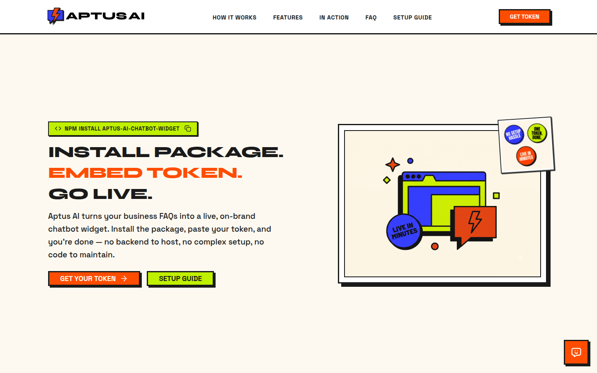
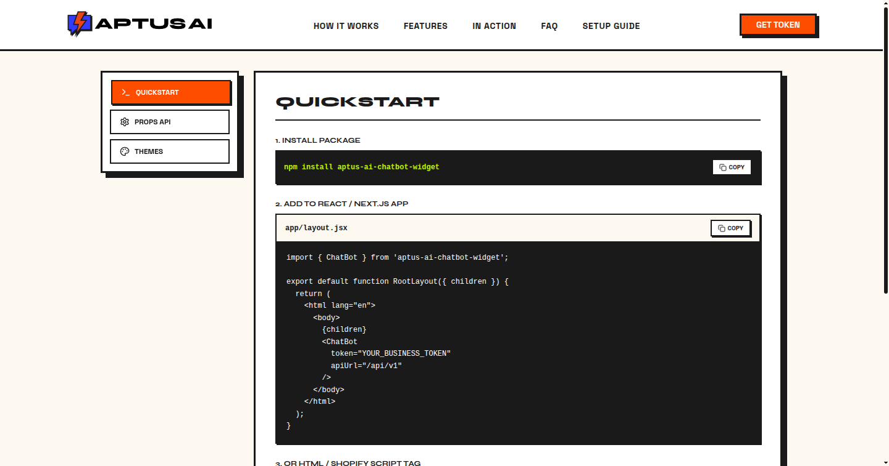
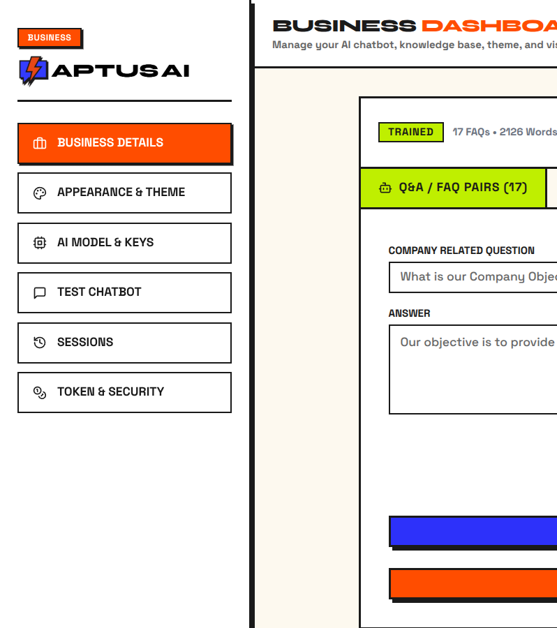
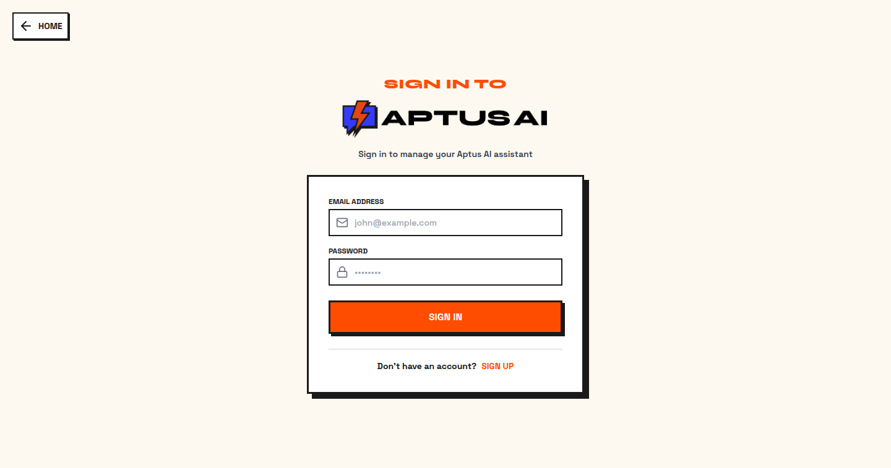
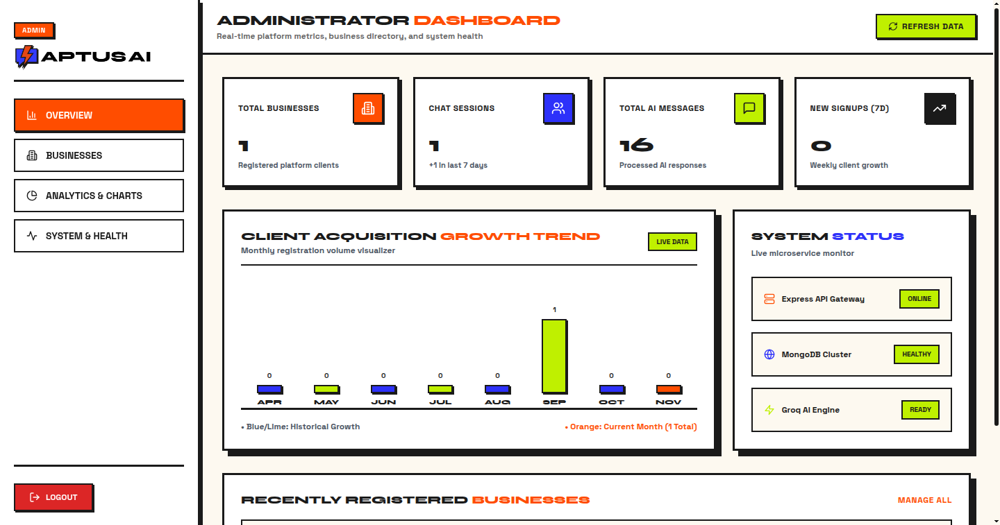
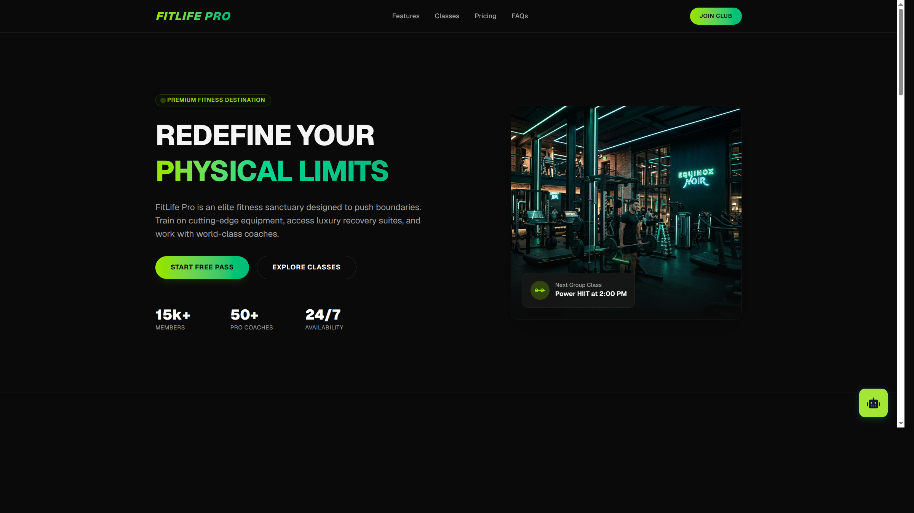
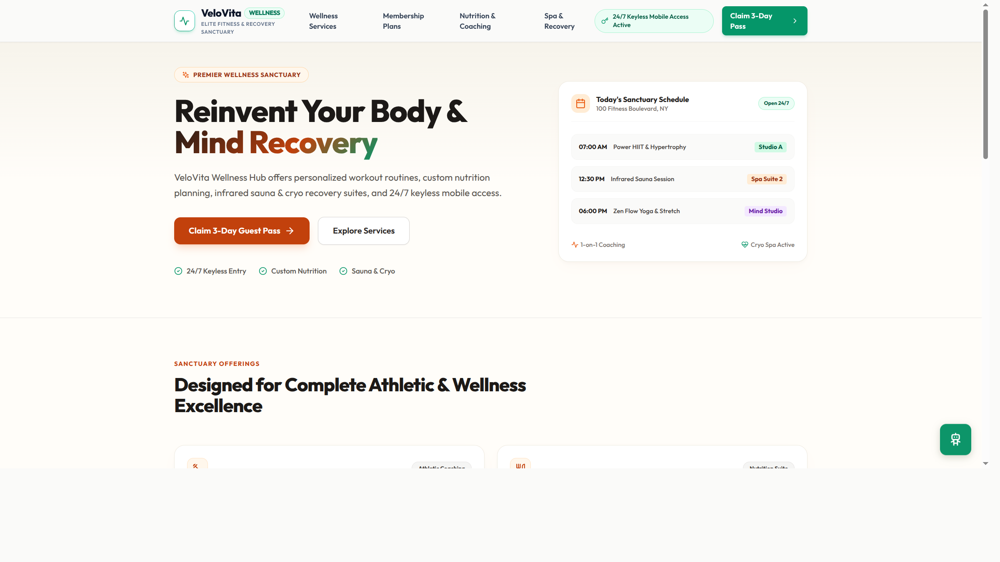
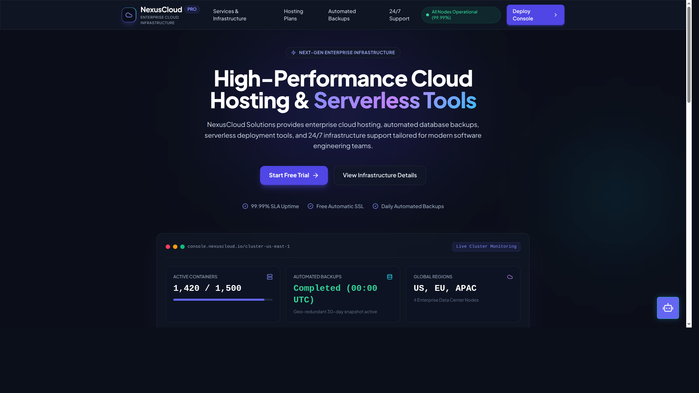

# Aptus AI

[](https://www.npmjs.com/package/aptus-ai-chatbot-widget)
[](./LICENSE)
[](https://nextjs.org/)

Multi-tenant chatbot platform: train on FAQs and Markdown, pick an LLM provider in the dashboard, embed the same bot on any site with the npm widget.

**Live app:** [aptus-ai-full-stack.vercel.app](https://aptus-ai-full-stack.vercel.app)  
**npm widget:** [aptus-ai-chatbot-widget](https://www.npmjs.com/package/aptus-ai-chatbot-widget) · [GitHub](https://github.com/hashirsajid58200p/aptus-ai-chatbot-widget)

---

## Links

| What | URL |
|------|-----|
| Platform (this repo) | https://github.com/hashirsajid58200p/aptus-ai-full-stack |
| Embeddable widget | https://github.com/hashirsajid58200p/aptus-ai-chatbot-widget |
| npm package | https://www.npmjs.com/package/aptus-ai-chatbot-widget |
| Production | https://aptus-ai-full-stack.vercel.app |

---

## Screenshots

### Landing


### Docs


### Business dashboard


### Auth


### Admin


### Demo sites with the widget

| FitLife Pro | VeloVita Wellness | NexusCloud |
|---|---|---|
|  |  |  |

---

## What it does

- Answers only from business Q&A and Markdown (knowledge gate: 10 FAQs or 1,000+ words before chat unlocks).
- 11+ inference providers via dashboard keys (Groq, OpenAI, Gemini, Anthropic, DeepSeek, Mistral, Perplexity, Cohere, xAI, OpenRouter, custom OpenAI-compatible).
- Live agent takeover over Socket.io.
- Voice input: browser Web Speech + Groq Whisper on the server.
- Domain allowlist + chatbot token for embeds.
- 14 theme presets synced from the dashboard without redeploying the host site.

---

## Repo layout

```
aptus-ai-full-stack/
├── backend/          Express API, MongoDB, Socket.io, LLM gateway
├── frontend/         Next.js 14 portal (business + admin)
├── demo/             FitLife_Pro, NexusCloud_Pro, VeloVita_Wellness
├── previews/         README screenshots
└── vercel.json       Frontend + backend services + /api rewrites
```

The widget lives in a **separate** repo and package: `aptus-ai-chatbot-widget` (current published version **1.0.17**).

---

## Stack

| Layer | Tech |
|-------|------|
| Frontend | Next.js 14, Tailwind, Redux Toolkit |
| Backend | Node, Express, Mongoose, Socket.io |
| Data | MongoDB Atlas |
| Widget | React, styled-components, tsup (ESM + CJS) |

---

## Quick start: widget

```bash
npm install aptus-ai-chatbot-widget
```

```jsx
import { ChatBot } from 'aptus-ai-chatbot-widget';

export default function RootLayout({ children }) {
  return (
    <html lang="en">
      <body>
        {children}
        <ChatBot
          token="YOUR_BUSINESS_TOKEN"
          apiUrl="https://your-api.domain.com/api/v1"
        />
      </body>
    </html>
  );
}
```

Full props and themes: [widget README](https://github.com/hashirsajid58200p/aptus-ai-chatbot-widget#readme).

---

## Local development

### Backend

```bash
cd backend
npm install
# copy backend/config/.env.example → backend/config/.env and fill values
npm run server
```

Minimum `.env` keys: `DB_URI`, `JWT_SECRET`, `ADMIN_JWT_SECRET`, `GROQ_API_KEY` (landing STT / demo fallback), `FRONTEND_URL`.

### Frontend

```bash
cd frontend
npm install
# frontend/.env.local → NEXT_PUBLIC_API_URL=/api/v1  (or http://localhost:3100/api/v1)
npm run dev
```

### Tests

```bash
cd backend
node test-suite.js
```

---

## Demos

| Demo | Stack | Dev port |
|------|--------|----------|
| FitLife_Pro | Next.js | (Next default) |
| NexusCloud_Pro | Vite | 3005 |
| VeloVita_Wellness | Vite | 3006 |

Each embeds `aptus-ai-chatbot-widget` with a seeded demo token.

---

## Deploy (Vercel)

`vercel.json` wires Next frontend + Express backend, with `/api/*` rewritten to the backend. Set project env vars from `backend/config/.env.example` and `frontend/.env.example`. Use `NEXT_PUBLIC_API_URL=/api/v1` on the same project so the browser stays same-origin.

---

## License

[MIT](./LICENSE) © Hashir Sajid (Aptus AI)
